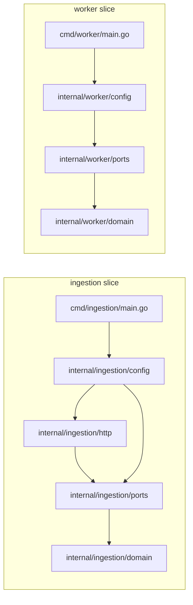

# Diseño: Backend Setup (Bootstrap/Scaffolding)

## Overview

Este documento describe el diseño de la configuración base del backend del Portal Corporativo de Monitoreo de Flotas y Telemetría. El propósito de esta Spec es establecer la estructura de proyecto, el módulo Go, las interfaces fundamentales (ports), los adaptadores de entrada HTTP y la infraestructura de configuración y logging, sin incorporar lógica de negocio ni adaptadores de salida hacia Kafka o TimescaleDB.

La solución aplica **Vertical Slice Architecture** dentro de `internal/`: cada servicio (`ingestion`, `worker`) es un slice autónomo con su propio dominio, ports, adaptadores e infraestructura de configuración. No existe código compartido entre slices; cuando los tipos son idénticos en ambos servicios (como `TraceID` o `AppError`) se duplican intencionalmente. Esta decisión prioriza la capacidad de extracción futura de cada servicio sobre la abstracción prematura: si en el futuro los servicios divergen o uno se extrae a su propio repositorio, no hay refactorización de paquetes compartidos.

La solución usa Go como lenguaje de implementación y Gin como framework HTTP. El dominio de cada slice no conoce a Gin ni a ningún driver externo; los ports definen contratos; y la infraestructura de configuración conecta las piezas a través del `DependencyComposer` propio de cada slice.

Al finalizar esta Spec quedan disponibles dos binarios arrancables (`ingestion` y `worker`), un servidor HTTP con middleware de trace, logging y manejo de errores, un health endpoint funcional, apagado controlado y logging estructurado con `trace_id`. No existe todavía lógica de negocio, casos de uso ni adaptadores hacia sistemas externos.

## Architecture

### Estructura de directorios

La siguiente estructura refleja únicamente los archivos creados en esta Spec. No se crean `outbound/`, ni `usecases/`, ni `tests/`.

```text
backend/go/
├── go.mod
├── go.sum
├── Makefile
├── cmd/
│   ├── ingestion/
│   │   └── main.go      # imports only internal/ingestion
│   └── worker/
│       └── main.go      # imports only internal/worker
└── internal/
    ├── ingestion/
    │   ├── domain/
    │   │   ├── errors.go
    │   │   └── trace.go
    │   ├── ports/
    │   │   ├── config.go
    │   │   ├── logging.go
    │   │   ├── server.go
    │   │   └── health.go
    │   ├── http/
    │   │   ├── router.go
    │   │   ├── middleware/
    │   │   │   ├── trace_id.go
    │   │   │   ├── logging.go
    │   │   │   └── error.go
    │   │   └── health/
    │   │       └── handler.go
    │   └── config/
    │       ├── loader.go
    │       ├── validator.go
    │       ├── composer.go
    │       └── logger.go
    └── worker/
        ├── domain/
        │   ├── errors.go
        │   └── trace.go
        ├── ports/
        │   ├── config.go
        │   └── logging.go
        └── config/
            ├── loader.go
            ├── validator.go
            ├── composer.go
            └── logger.go
docker-compose.yml
.env.example
```

### Diagrama de contenedores

Cada servicio es un slice independiente. No hay importaciones cruzadas entre `ingestion slice` y `worker slice`.



## Components and Interfaces

### Slice: ingestion

#### Dominio (`internal/ingestion/domain/`)

El dominio del slice `ingestion` contiene tipos propios sin dependencias externas. Ningún archivo bajo `internal/ingestion/domain` importa Gin, Kafka, drivers SQL ni bibliotecas de infraestructura. El nombre del paquete es `domain`.

```go
// internal/ingestion/domain/errors.go
// package domain

// AppError is the base error type for the api domain layer.
type AppError struct {
    Code          string
    Message       string
    Inner         error
    IsRecoverable bool
}

func (e *AppError) Error() string
func (e *AppError) Unwrap() error
func NewAppError(code, message string, inner error) *AppError
func NewRecoverableError(code, message string, inner error) *AppError
```

```go
// internal/ingestion/domain/trace.go
// package domain

// TraceID is a correlation identifier scoped to a single request.
type TraceID string

// NewTraceID generates a new UUID v4 trace identifier.
func NewTraceID() TraceID

// ContextWithTraceID stores the TraceID in the context using an unexported key.
func ContextWithTraceID(ctx context.Context, tid TraceID) context.Context

// TraceIDFromContext retrieves the TraceID from the context.
// Returns ("", false) if not present.
func TraceIDFromContext(ctx context.Context) (TraceID, bool)
```

#### Ports (`internal/ingestion/ports/`)

Los ports del slice `ingestion` definen contratos que los adaptadores implementan. No importan Gin, zap ni ninguna biblioteca de infraestructura. El nombre del paquete es `ports`.

```go
// internal/ingestion/ports/config.go
// package ports

type Config struct {
    HTTP struct {
        Port            int           // env: HTTP_PORT, default: 8080, range: 1-65535
        ReadTimeout     time.Duration // env: HTTP_READ_TIMEOUT, default: 15s, min: 1s
        WriteTimeout    time.Duration // env: HTTP_WRITE_TIMEOUT, default: 15s, min: 1s
        ShutdownTimeout time.Duration // env: HTTP_SHUTDOWN_TIMEOUT, default: 30s, range: 1-300s
    }
    Logging struct {
        Level  string // env: LOG_LEVEL, default: "info"
        Format string // env: LOG_FORMAT, default: "json"
    }
}
// No Kafka, no PostgreSQL — those come in the ingestion Spec

type ConfigLoader interface {
    Load() (Config, error)
}

type Validator interface {
    Validate(cfg Config) []ValidationError
}

type ValidationError struct {
    Field   string
    Rule    string
    Message string
}
```

```go
// internal/ingestion/ports/logging.go
// package ports

type Logger interface {
    Info(msg string, fields ...Field)
    Warn(msg string, fields ...Field)
    Error(msg string, fields ...Field)
    Fatal(msg string, fields ...Field)
    DPanic(msg string, fields ...Field)
    Panic(msg string, fields ...Field)
    WithTraceID(ctx context.Context, tid domain.TraceID) context.Context
    GetTraceID(ctx context.Context) domain.TraceID
    WithFields(fields ...Field) Logger
}

type Field struct {
    Key   string
    Value interface{}
}

func BuildFields(pairs ...interface{}) []Field
```

```go
// internal/ingestion/ports/server.go
// package ports

type HTTPServer interface {
    Start() error
    Stop(ctx context.Context) error
}
```

```go
// internal/ingestion/ports/health.go
// package ports

type HealthChecker interface {
    Check(ctx context.Context) (bool, error)
}
```

#### Adaptadores HTTP (`internal/ingestion/http/`)

El paquete usa `package ingestionhttp` para evitar conflicto de nombres con la biblioteca estándar `net/http` cuando ambos se importan en el mismo archivo.

**`internal/ingestion/http/router.go`** — `package ingestionhttp`

Construye el motor Gin y el `http.Server`. Registra los middleware en el orden: `trace_id → logging → recovery/error`. Define los handlers de `NoRoute` y `NoMethod` con Problem Details. Implementa la interfaz `ports.HTTPServer`.

```go
func NewRouter(
    cfg ports.Config,
    logger ports.Logger,
    healthChecker ports.HealthChecker,
) *Router

// Start binds the configured port and starts the HTTP server in a non-blocking goroutine.
func (r *Router) Start() error

// Stop calls http.Server.Shutdown with the provided context.
func (r *Router) Stop(ctx context.Context) error
```

`gin.New()` se usa en lugar de `gin.Default()` para controlar explícitamente los middleware. `HandleMethodNotAllowed = true` habilita las respuestas 405. `registerRoutes()` registra únicamente `GET /health` en esta Spec.

---

**`internal/ingestion/http/middleware/trace_id.go`**

Middleware de Gin que extrae el header `X-Trace-ID`. Si el valor tiene formato UUID v4 válido (36 caracteres, formato estándar `xxxxxxxx-xxxx-xxxx-xxxx-xxxxxxxxxxxx`) lo reutiliza como `TraceID`. En cualquier otro caso (ausente, vacío, formato inválido) genera uno nuevo con `domain.NewTraceID()`. Almacena el `TraceID` en el contexto con `domain.ContextWithTraceID`. Escribe el `TraceID` en el header de respuesta `X-Trace-ID` antes de llamar a `c.Next()`.

---

**`internal/ingestion/http/middleware/logging.go`**

Middleware de Gin que registra por cada solicitud los campos: método HTTP, path, código de estado, latencia en milisegundos y `trace_id`. Lee el `TraceID` del contexto con `domain.TraceIDFromContext` después de `c.Next()`. No registra el query string, los headers `Authorization` o `Cookie`, ni el cuerpo de la solicitud.

---

**`internal/ingestion/http/middleware/error.go`**

Implementa el recovery de panics de Gin y las respuestas de error estándar.

```go
// ProblemDetails represents an RFC 9457 error response.
// All field names are in English per api-standards.
type ProblemDetails struct {
    Type     string `json:"type"`
    Title    string `json:"title"`
    Status   int    `json:"status"`
    Detail   string `json:"detail,omitempty"`
    Instance string `json:"instance,omitempty"`
}
```

- Panic recovery → 500 Problem Details. El stack trace se registra en los logs (con `trace_id`) pero nunca se incluye en la respuesta al cliente.
- `NoRoute` → 404 Problem Details.
- `NoMethod` → 405 Problem Details.
- `Content-Type: application/problem+json` en todas las respuestas de error.

---

**`internal/ingestion/http/health/handler.go`**

```go
type HealthHandler struct {
    checker ports.HealthChecker
}

func NewHealthHandler(checker ports.HealthChecker) *HealthHandler

// Handle calls checker.Check with a 1-second context timeout.
// Responds 200 {"status":"healthy"} if healthy == true.
// Responds 503 {"status":"unhealthy"} if healthy == false or err != nil.
// The error detail is never included in the response body.
func (h *HealthHandler) Handle(c *gin.Context)
```

#### Infraestructura de configuración (`internal/ingestion/config/`)

El nombre del paquete es `config`.

**`internal/ingestion/config/loader.go`** — `EnvConfigLoader`

Lee variables de entorno con `os.LookupEnv`. Lee únicamente: `HTTP_PORT`, `HTTP_READ_TIMEOUT`, `HTTP_WRITE_TIMEOUT`, `HTTP_SHUTDOWN_TIMEOUT`, `LOG_LEVEL`, `LOG_FORMAT`. No hay campos de Kafka ni PostgreSQL en este slice. `getEnvRequired(key string) (string, error)` devuelve error si la variable no está definida. `parseInt(value, field string) (int, error)` y `parseDuration(value, field string) (time.Duration, error)` devuelven error con el nombre del campo si el formato es incorrecto. El error identifica el campo sin incluir su valor.

---

**`internal/ingestion/config/validator.go`** — `ConfigValidator`

```go
func (v *ConfigValidator) Validate(cfg ports.Config) []ports.ValidationError
```

Valida: `HTTP.Port` en rango 1–65535; `HTTP.ReadTimeout` y `HTTP.WriteTimeout` ≥ 1s; `HTTP.ShutdownTimeout` entre 1s y 300s. Cada `ValidationError` incluye `Field` y `Message` sin el valor del campo.

---

**`internal/ingestion/config/composer.go`** — `DependencyComposer`

```go
func NewDependencyComposer(cfg ports.Config, logger ports.Logger) *DependencyComposer

// ComposeAPI wires HealthHandler, middleware and Router together, returning an HTTPServer.
func (c *DependencyComposer) ComposeAPI() (ports.HTTPServer, error)
```

Si la construcción de cualquier dependencia falla, libera los recursos ya inicializados y retorna error. La composición nunca filtra recursos en caso de fallo.

---

**`internal/ingestion/config/logger.go`** — `ZapLogger`

```go
// NewLogger creates a JSON-encoded zap logger implementing ports.Logger.
// The second return value is a cleanup function that calls logger.Sync().
func NewLogger(cfg ports.Config) (ports.Logger, func(), error)
```

`ZapLogger` envuelve `*zap.Logger` con codificación JSON. Los campos base del encoder son `timestamp`, `level` y `message`. `WithTraceID` almacena el `TraceID` en el contexto; `GetTraceID` lo recupera e inyecta en cada entrada de log como campo `trace_id`. No registra tokens, contraseñas ni claves en ninguna entrada.

#### Punto de entrada — Ingestion

```
cmd/ingestion/main.go  (imports only internal/ingestion/...):
load config (EnvConfigLoader + ConfigValidator)
  └─ error → stderr + os.Exit(1)        // no ports opened, no external connections
NewLogger()
  └─ error → stderr + os.Exit(1)
DependencyComposer.ComposeAPI()
  └─ error → log + cleanup + os.Exit(1)
server.Start() in goroutine
signal(SIGINT, SIGTERM) → server.Stop(ctx with HTTP.ShutdownTimeout)
second signal during shutdown → os.Exit(1) immediately
```

---

### Slice: worker

Los tipos del slice `worker` son copias independientes de los del slice `ingestion`. La identidad de implementación es intencional y no crea un acoplamiento: cada slice puede evolucionar de forma autónoma.

#### Dominio (`internal/worker/domain/`)

```go
// internal/worker/domain/errors.go — independent copy of internal/ingestion/domain/errors.go
// internal/worker/domain/trace.go  — independent copy of internal/ingestion/domain/trace.go
// package domain
```

Los tipos `AppError` y `TraceID` son idénticos a los del slice `ingestion` pero residen en paquetes distintos. No hay importación cruzada entre slices.

#### Ports (`internal/worker/ports/`)

```go
// internal/worker/ports/config.go
// package ports

type Config struct {
    Worker struct {
        ShutdownTimeout time.Duration // env: WORKER_SHUTDOWN_TIMEOUT, default: 30s, range: 1-300s
    }
    Logging struct {
        Level  string // env: LOG_LEVEL, default: "info"
        Format string // env: LOG_FORMAT, default: "json"
    }
}
// No HTTP, no Kafka, no PostgreSQL — those come in the ingestion Spec

// ConfigLoader, Validator, ValidationError — independent copies, identical to api/ports
```

```go
// internal/worker/ports/logging.go
// package ports
// Logger, Field, BuildFields — independent copy of internal/ingestion/ports/logging.go
```

#### Infraestructura de configuración (`internal/worker/config/`)

- **`loader.go`**: `EnvConfigLoader`; lee únicamente `WORKER_SHUTDOWN_TIMEOUT`, `LOG_LEVEL`, `LOG_FORMAT`; copia independiente del loader del slice `ingestion`.
- **`validator.go`**: `ConfigValidator`; valida `Worker.ShutdownTimeout` en rango 1–300s; copia independiente.
- **`logger.go`**: `NewLogger` y `ZapLogger`; idéntico a `internal/ingestion/config/logger.go`; copia independiente.
- **`composer.go`**:

```go
func NewDependencyComposer(cfg ports.Config, logger ports.Logger) *DependencyComposer

// ComposeWorker returns a cleanup function for worker resources (skeleton for this Spec).
// Message consumption logic is implemented in the ingestion Spec.
func (c *DependencyComposer) ComposeWorker() (func(), error)
```

#### Punto de entrada — Worker

```
cmd/worker/main.go  (imports only internal/worker/...):
load config (EnvConfigLoader + ConfigValidator)
  └─ error → stderr + os.Exit(1)
NewLogger()
  └─ error → stderr + os.Exit(1)
DependencyComposer.ComposeWorker()
  └─ error → log + cleanup + os.Exit(1)
// Message consumption: ingestion Spec
signal(SIGINT, SIGTERM) → cleanup() → os.Exit(0) within 10 seconds
second signal → os.Exit(1) immediately
```

## Data Models

**`TraceID` (ambos slices)**

Alias de tipo `string` definido en el paquete `domain` de cada slice. Representa un UUID v4. Generado por `domain.NewTraceID()` usando `github.com/google/uuid`. Propagado mediante `context.Context` a través de los helpers `ContextWithTraceID` y `TraceIDFromContext`. No se serializa en cuerpos de respuesta; se transmite exclusivamente como header HTTP `X-Trace-ID`.

**`AppError` (ambos slices)**

Struct simple del dominio que implementa `error` y `Unwrap()`. El campo `IsRecoverable` se reserva para la lógica de reintentos del worker en Specs futuras. No tiene dependencias de infraestructura.

**`Config` (slice ingestion)**

Struct con campos anidados `HTTP` y `Logging`. Se carga una vez al arranque, se valida completamente como una unidad y se pasa por inyección de dependencias. No muta tras el arranque. No contiene campos de Kafka ni PostgreSQL — estos se añaden en la Spec de ingesta cuando el slice `ingestion` los necesite.

**`Config` (slice worker)**

Struct con campos anidados `Worker` y `Logging`. Solo contiene lo necesario para el setup base del worker. No contiene campos HTTP, Kafka ni PostgreSQL.

**`ValidationError` (ambos slices)**

Struct del port de configuración de cada slice. Contiene `Field` (nombre del campo), `Rule` (regla violada) y `Message` (descripción sin el valor del campo).

**`ProblemDetails` (solo slice ingestion)**

Struct del adaptador de error HTTP. Serializa a JSON con los nombres de campo en inglés conformes a RFC 9457: `type`, `title`, `status`, `detail`, `instance`.

> Los tipos `TraceID`, `AppError`, `ValidationError` y la interfaz `Logger` se definen de forma independiente en cada slice. Esta duplicación es intencional: permite que cada servicio evolucione su dominio sin afectar al otro.

## Error Handling

Se define un tipo de error base en el dominio de cada slice: `AppError`. Las capas superiores envuelven y propagan errores usando `fmt.Errorf` con `%w` o `NewAppError`.

La gestión de errores HTTP reside en `internal/ingestion/http/middleware/error.go` y sigue este esquema:

| Situación | Código HTTP | Tipo Problem Details |
|---|---|---|
| Ruta no existe | 404 | `about:blank` |
| Método no admitido | 405 | `about:blank` |
| Panic / error inesperado | 500 | `about:blank` |

El campo `detail` de las respuestas Problem Details contiene solo texto seguro: nunca stack traces, rutas del sistema de archivos, sentencias SQL ni valores de secretos. Los detalles internos se registran únicamente en los logs, asociados al `trace_id` de la solicitud que originó el error.

El middleware de recovery captura cualquier panic de Go, registra el stack trace en los logs (con `trace_id`) y responde al cliente con un 500 Problem Details sin exponer el stack.

Los errores de configuración y composición de dependencias terminan el proceso antes de que se abra cualquier puerto, evitando que el servicio arranque en estado inconsistente.

El `Worker_Service` no tiene manejo de errores HTTP en esta Spec; su gestión de errores es exclusivamente por logs y código de salida.

## Decisiones de diseño

**1. Binarios independientes por servicio (Ingestion y worker)**

`cmd/ingestion` y `cmd/worker` se compilan como binarios separados. Esta decisión permite escalar, desplegar y reiniciar cada proceso de forma independiente, lo cual es coherente con los requisitos del MVP donde el servicio de ingesta y el worker de procesamiento tienen ciclos de vida distintos.

**2. Ports para inversión de dependencias**

Las interfaces en `internal/ingestion/ports` e `internal/worker/ports` invierten las dependencias: los adaptadores dependen de los ports, no al revés. Esto permite sustituir implementaciones (por ejemplo, reemplazar `ZapLogger` por otro logger) sin modificar el dominio, y facilita las pruebas unitarias mediante mocks en Specs futuras.

**3. trace_id como Correlation ID por request**

Se genera o reutiliza un `TraceID` (UUID v4) en el middleware del servicio de ingesta. Se propaga en los logs de esa solicitud y se devuelve en el header `X-Trace-ID`. El nombre `trace_id` es consistente con la nomenclatura del stack de observabilidad objetivo. La propagación a Kafka para correlacionar logs del worker se implementa en la Spec de ingesta.

**4. Problem Details (RFC 9457) para errores HTTP**

Se adopta el estándar RFC 9457 como contrato único de respuestas de error del slice `ingestion`. Evita la creación de formatos ad hoc, simplifica la interpretación por parte de consumidores y es coherente con los estándares de API definidos en `api-standards.md`.

**5. Graceful shutdown con timeout configurable**

El timeout de apagado es configurable para adaptarse a distintos entornos (desarrollo, demo, producción futura). El comportamiento de doble señal (segunda señal fuerza terminación inmediata) sigue el patrón estándar de los sistemas Unix, previniendo bloqueos indefinidos durante el apagado.

**6. Vertical Slice Architecture dentro de `internal/`**

Decisión: cada servicio (`ingestion`, `worker`) es un slice autónomo bajo `internal/`. No existe código compartido entre slices. Cuando los tipos son idénticos en ambos servicios (como `TraceID` o `AppError`), se duplican.

Justificación: facilita la extracción futura de cada servicio a su propio repositorio sin refactorización. Evita acoplamientos accidentales entre servicios. La duplicación controlada es preferible a una abstracción compartida que luego requiere condicionales por servicio o versionado coordinado.

Consecuencia: los archivos como `domain/errors.go` y `domain/trace.go` existen por duplicado en `internal/ingestion/domain/` e `internal/worker/domain/`. Si los tipos divergen en el futuro, cada servicio puede evolucionar independientemente sin afectar al otro.

## Dependencias

| Dependencia | Versión | Propósito |
|---|---|---|
| `github.com/gin-gonic/gin` | `v1.9.1` | Framework HTTP (solo slice ingestion) |
| `go.uber.org/zap` | `v1.27.0` | Logging estructurado (ambos slices) |
| `github.com/google/uuid` | `v1.6.0` | Generación de TraceID (UUID v4) (ambos slices) |

Las versiones son exactas (sin rangos ni comodines). Las dependencias transitivas quedan fijadas en `go.sum`. No se incorporan bibliotecas adicionales en esta Spec.

## Ejemplos de uso

```bash
# Compilar los binarios
make build-ingestion
make build-worker

# Levantar el entorno local (solo el servicio ingestion)
docker compose up -d

# Verificar el health endpoint
curl http://localhost:8080/health
# Respuesta esperada: {"status":"healthy"}

# Verificar trace_id: reutilización desde el cliente
curl -i -H "X-Trace-ID: 123e4567-e89b-12d3-a456-426614174000" http://localhost:8080/health
# El header X-Trace-ID de la respuesta contendrá el mismo UUID

# Verificar Problem Details en ruta inexistente
curl -i http://localhost:8080/no-existe
# Respuesta esperada: HTTP 404 con Content-Type: application/problem+json
```
